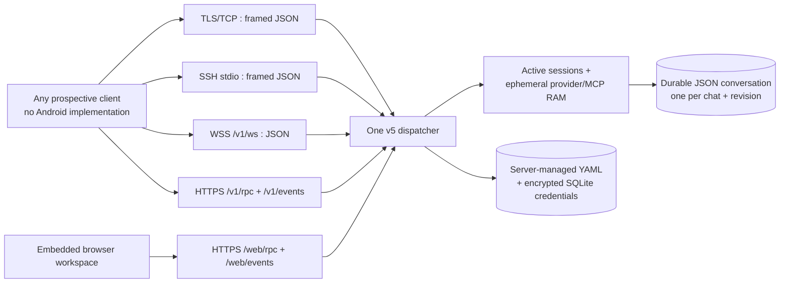
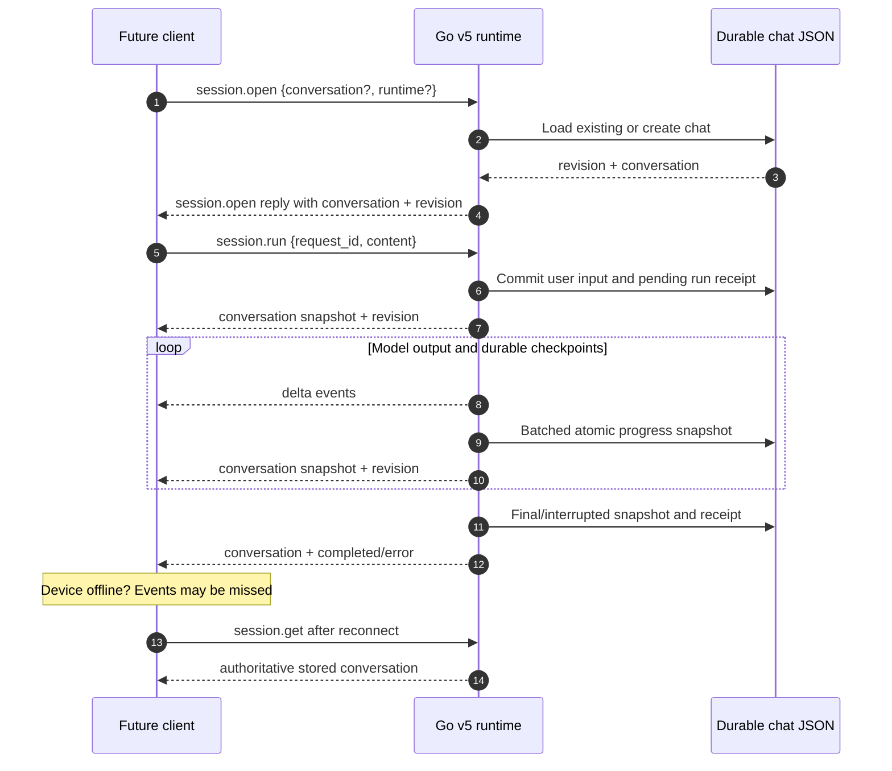

# ServerSide v5 — API offered to future clients

**Current server contract:** every conversation is stored durably on the Go server, independent of any mobile sync preference. The Android Server Connection implementation is in progress; consult its tracker for verified support.

## 1. Protocol architecture



Every ServerSide session uses durable chat storage. Provider/MCP credentials supplied at runtime by a client exist only in RAM; the server's *locally managed* provider credentials use encrypted SQLite and are not confused with the mobile handoff.

## 2. Public API endpoints

| Endpoint / channel | Purpose | Authentication |
| --- | --- | --- |
| `GET /v1/capabilities` | Protocol version, transports, supported operations | TLS or local loopback policy |
| `POST /v1/pair` | Redeem a one-time HTTP/WS pairing URL code | HTTPS + trusted certificate/SPKI pin, code in JSON body |
| `POST /v1/auth` | Exchange paired HTTP/WS `client_id` and `secret` for a short-lived bearer token (currently 900 seconds) | Paired HTTP/WS credentials |
| `POST /v1/rpc` | Common v5 JSON request/reply | `Authorization: Bearer <token>` |
| `GET /v1/events?session_id=...&after=...` | Server events by SSE (default) or JSON long poll (`Accept: application/json`) | Same bearer |
| `GET /v1/ws` | Full-duplex JSON RPC and events | WS `auth` text frame first |
| TLS/TCP | Length-prefixed JSON frames (4-byte big-endian size) | SSH-enrolled TCP identity |
| `generative stream --stdio` | Same framed RPC via SSH + private daemon socket | SSH-enrolled TCP identity |

Mobile HTTP/WS uses the existing HTTPS or loopback transport policy. Opening a mobile invitation URL at `/connect` serves the embedded browser client without redeeming the code. The mobile client verifies TLS and the SPKI pin and explicitly calls `POST /v1/pair`.

### Embedded browser routes

| Endpoint | Purpose | Authentication |
| --- | --- | --- |
| `GET /web/auth/status` | `configured` and `authenticated` flags, plus a public `session_version` for an authenticated session | Configured origin, optional session cookie |
| `POST /web/auth/bootstrap` | Accept `{}` and establish a cookie session in an enabled passwordless origin | Same-origin protected POST and no effective password |
| `POST /web/auth/login` | Accept `{"password":"…"}`, rotate the session cookie, and return the public `session_version` | Effective web password from flag, environment or local CLI |
| `POST /web/auth/logout` | Accept `{}`, revoke the current session and clear the cookie | Session cookie and matching session version when cookie is present |
| `POST /web/rpc` | v5 RPC envelope and error mapping | Session cookie and matching session version |
| `GET /web/events?session_id=...&after=...` | Existing SSE and JSON long-poll semantics, including event cursor and revisions | Session cookie and matching session version |

All web POSTs require `Content-Type: application/json`, the exact configured `Origin` and `X-Generative-Web: 1`. The browser sends `X-Generative-Session: <session_version>` on RPC, event and logout requests. The version binds requests to the current cookie across tabs and rotates with it. Only the server-issued HttpOnly cookie carries the session credential. Responses are non-cacheable. Cross-site fetches are rejected, and these endpoints expose no cross-origin CORS access.

The default numeric loopback listener allows passwordless access when the web password is unset. Every actual passwordless daemon start with HTTP enabled warns on stderr. Anyone who can reach a passwordless origin can access its workspace. Keep loopback HTTP isolated from proxies. It requires matching the numeric listener and rejects forwarding headers.

Remote access uses the exact `--web-origin` over HTTPS. Restrict access to the upstream and set `--web-trusted-proxy` to the proxy's socket peer IP. The proxy preserves the public `Host` and overwrites `X-Forwarded-Proto`. Plain HTTP at the proxy must redirect or fail. Web auth trusts no forwarded client IP fields. A password is required for HTTPS unless administrators explicitly enable `--allow-public-web-without-password`. [Setup and service examples](../README.md#web-chat-client)

The daemon resolves `--web-password` before `GENERATIVE_WEB_PASSWORD`, then falls back to the saved verifier or passwordless mode. Explicit empty overrides fail startup. Saved-password editing is available via the private socket with `generative web password set`, `reset` or `unset`. Overrides apply at startup and persist only as a salted restart-comparison verifier. Saved edits take effect when the override is removed and the daemon restarts. [Password and service configuration](../README.md#web-chat-client)

A browser session resolves to the server-owned web workspace. Mobile bearer credentials authenticate on the mobile endpoints. Signing out, changing the effective password or mode, or running `generative web sessions revoke-all` closes affected streams and preserves workspace history. Sessions have a 24-hour RPC idle limit and a seven-day absolute lifetime. Idle SSE and status polling do not renew them. Native terminal and coding-agent RPCs remain available to paired clients subject to the existing server opt-ins. Existing browser-paired chats remain under their original owner. Use the legacy authenticated export flow or the local admin export commands to retain access. [Old browser history and export](../README.md#web-chat-client)

## 3. Pairing and authentication

```mermaid
sequenceDiagram
    autonumber
    actor Operator
    participant CLI as ServerSide CLI
    participant Client as Future HTTP/WS client
    participant API as Go server
    Operator->>CLI: pair --transport http --endpoint HTTPS --pin SPKI
    CLI-->>Operator: Complete HTTPS URL + identical QR
    Operator-->>Client: Copy URL or scan QR
    Note over Client: Verify HTTPS/SPKI before sending one-time code
    Client->>API: POST /v1/pair {"code":"..."}
    API-->>Client: client_id + long-lived secret + endpoint + TLS pin
    Note over Client: Securely store paired identity; discard code
    Client->>API: POST /v1/auth {"client_id":"...","secret":"..."}
    API-->>Client: Bearer token + expiry
    Client->>API: POST /v1/rpc (Bearer token)
    API-->>Client: RPC reply
```

The server displays `https://host/connect#code=...&pin=sha256%2F...&v=1` as full copyable text and a QR with exactly the same URL. Never put the one-time fragment code into HTTP paths, logs or durable files. WebSocket first sends `{"type":"auth","protocol":5,"client_id":"...","secret":"..."}` and receives `{"type":"paired","protocol":5,"client_id":"..."}`.

**TCP is enrolled only via authenticated SSH**, e.g. `ssh -T USER@HOST generative pair --stdio --transport tcp`. The resulting identity can use TCP or the SSH stdio fallback, but not HTTP/WS without explicit separate pairing. An HTTP/WS URL-paired identity cannot be used to enroll a TCP client.

Once the CLI is installed, run `generative pair --stdio --transport tcp` and `generative stream --stdio` directly over SSH. On Linux and macOS, each command waits for its default Unix socket and starts the existing user service if needed. When no daemon or service is present, it registers the service with default settings. An explicit `--ipc` or `--data-socket` connects to that socket only. Startup diagnostics go to stderr. Pairing stdout contains one JSON response, and stream stdout carries framed v5 messages. Automatic connection retries happen before any request is sent.

SSH stdio defaults to cursor polling with `session.events` and never injects unsolicited events when `session.open` omits `after`. To request push delivery over SSH, explicitly supply an `after` cursor in `session.open` or `session.open_chunked`. TCP and WebSocket continue to support push on both open operations.

## 4. Canonical RPC and automatic conversation delivery

A client does **not** send a sync or storage flag. The Go server always persists chat history; `runtime` carries transient provider/MCP settings only when needed.

Open/create a conversation:

```json
{"id":"open-1","op":"session.open","session_id":"chat-1","data":{"conversation":{"id":"chat-1","title":"Example","created_at":1,"updated_at":2,"messages":[]},"runtime":{"source":"mobile_ephemeral","provider":{"type":"openai","modelId":"example","auth":{"method":"bearer_token","value":"<RAM-only>"}}}}}
```

Successful response (actual field shape):

```json
{"id":"open-1","ok":true,"data":{"session_id":"chat-1","revision":1,"event_seq":0,"conversation":{"id":"chat-1","title":"Example","created_at":1,"updated_at":2,"messages":[]}}}
```

Start a job:

```json
{"id":"run-1","op":"session.run","session_id":"chat-1","data":{"request_id":"run-1","content":"Hello"}}
```

Successful acknowledgement:

```json
{"id":"run-1","ok":true,"data":{"request_id":"run-1"}}
```

The server emits `delta` events with answer text, `reasoning_delta` events
with provider-visible reasoning text and its answer offset, and `tool_activity`
events with a tool record keyed by activity ID. A tool activity reports provider
output. It does not authorize or invoke a tool. Arguments are published when they
can be checked as a complete value. Existing clients can ignore the additive
event kinds and read the same fields in the authoritative `conversation` event.
That event contains the latest stored chat and revision after the initial turn,
at durable progress checkpoints and at completion. Example shape:

```json
{"session_id":"chat-1","seq":3,"request_id":"run-1","kind":"conversation","data":{"revision":2,"conversation":{"id":"chat-1","title":"Example","created_at":1,"updated_at":3,"messages":[]}}}
```

To avoid transferring unchanged chat history, a client with a complete local
snapshot may call `session.open` (or `session.get`) with
`{"if_revision": <cached_revision>}`. The server still validates the authenticated
owner, opens the live session, and replies with
`{"session_id":"...","revision":N,"event_seq":M,"unchanged":true}` **only** when
the server's durable revision matches. Otherwise it returns the authoritative
full snapshot, or `resource_exhausted` for oversized whole-history replies;
clients must then use chunked reads. No cached history is uploaded to the server
by this operation. Clients must never treat `unchanged` as proof of ownership
without a successful authenticated response.

The capabilities negotiation reports `chat_features.negotiation.generation.max_run_content_bytes` (64 KiB for current text prompts) separately from `max_message_bytes` (512 KiB limit for a stored history message). Clients should use the former to validate new runs.

The `event_seq` on `session.open` and `session.get` is the current live
session event sequence at the instant the snapshot was captured. Clients must
subscribe to `/v1/events?after=event_seq` **before or after** sending a new
`session.run`, as long as no events are lost beyond the retention window. The
field is also included in `session.open_chunked`; it is an **in-memory cursor**,
not a durable revision, and resets when the server process/session restarts.
Clients must obtain a fresh `event_seq` from `session.open` before starting a
new run rather than reusing a persisted cursor. Existing clients may ignore
this additive field. No snapshot can replay already-evicted deltas; reconnect
must reconcile the durable `conversation` and must never replay an uncertain
`session.run` request automatically.

The event's `conversation.messages` is illustrative here. In reality it contains the newly stored user input and assistant/tool state; a client must not substitute the empty example for an actual response. A later `completed` event signals completion, while `error` reports a failed/interrupted operation. Event sequences are per active session, not persisted across daemon restarts.

| Operation | What it offers |
| --- | --- |
| `capabilities.get` | Discover version, operations and transports |
| `provider.catalog` | Authenticated, typed, read-only server-owned provider/model selection metadata |
| `session.open` | Create/resume **durable** chat; no `storage`; optional initial `conversation` and transient `runtime` |
| `session.open_chunked` / `session.read_chunk` | Open and retrieve a revision-bound conversation in bounded chunks |
| `session.upload.begin` / `session.upload.chunk` / `session.upload.commit` / `session.upload.abort` | Owner-scoped, checksummed CAS upload of a bounded conversation |
| `session.configure` | Replace transient provider/MCP/runtime settings in RAM |
| `session.run` / `session.cancel` | Start one request and optionally cancel by `request_id` |
| `session.get` | Full server conversation + `revision`; accepts `if_revision` and may return `unchanged` |
| `session.events` | Events after the requested `after` sequence |
| `session.save` | Explicit full chat edit; `expected_revision` and `idempotency_key` for atomic CAS |
| `identity.revoke` | Authenticated, self-only v5 RPC revocation for TCP/SSH-stdio pairing. Send no `data`; success returns `{ "revoked": true }`. Revocation ends future access under this identity but retains server history. Do not replay after an uncertain response. |
| `session.list` | Stored owner-scoped chats and tombstones (persistent across restart) |
| `session.close` | Release RAM runtime only, **not** history |
| `session.delete` | Explicit durable chat deletion with tombstone and revision check |
| `tool.list` / `tool.call` | Discover/execute authorized tools |
| `config.get` / `config.save` | Server-managed nonsecret YAML configuration |
| `terminal.*` / `agent.*` | Optional native tools when enabled by server administrator |

`session.list` returns a lightweight projection of conversation metadata, including
creation and update times, provider, model, profile, reasoning effort, token count,
and message/summary presence. Items are ordered by descending update time (or
deletion time for tombstones), then ascending ID. Offset pages are evaluated
independently: concurrent changes may move items between pages, so clients must
refresh the list rather than treat a multi-page traversal as a snapshot.

For stable traversal, call `session.list` with `{"pagination":"snapshot","limit":50}`.
Pass the returned `next_cursor` unchanged with the same pagination mode on subsequent
calls until it is empty. Rows and tombstones reflect one owner-scoped snapshot;
updates after its creation appear on a fresh traversal. Cursors can be retried,
expire after five minutes or server restart, and an expired/invalid cursor returns
`invalid_request`; restart the traversal. At most 32 snapshots, 100,000 retained rows, and approximately 32 MiB of
retained projection metadata are held per process; each projection is limited to
16 MiB and each returned page to 2 MiB. An oversized individual row or capacity
exhaustion returns `resource_exhausted`; values are never truncated. The server
validates one stored conversation at a time while projecting the list. The legacy
`offset` interface remains available but has no snapshot guarantees.

`provider.catalog` requires authentication and returns version 1, a catalog revision,
and `providers` with IDs, names, adapter types, `custom_model_id`, key-selection
metadata, and `models`. Each model has an ID, display name, `text_generation`,
`availability`, and nullable context/output limits (null means unknown). Availability
is `available`, `credential_unavailable`, `key_selection_required`, `unsupported`,
or `unavailable`; it reflects credential and adapter checks at the time of the request. Runtime
settings and upstream access are validated separately when executing; `available`
does not guarantee a successful run. For multiple keys, select an advertised key ID
explicitly; actual credential availability is checked at execution. An unrestricted
provider permits custom IDs and its displayed catalog need not be exhaustive. No
credential, credential reference, endpoint, or raw provider configuration is returned.

### Device identity revocation

A paired HTTP client can explicitly revoke its **own** identity with `POST
/v1/revoke` and an authenticated bearer token. The request body must be empty;
the endpoint does not accept a target client ID. Success returns
`{"revoked":true}`. The server removes that identity's pairing credentials
and terminates its active sessions/streams; previously issued bearer tokens,
future authentication, and new RPCs under that identity all fail. A second
request using the revoked token returns HTTP 401 (already revoked), not a
second success. Other paired identities remain usable.

Durable conversations owned by the revoked identity are **not deleted**, but
they are no longer accessible to a newly paired identity because each pairing
has separate history. Back up/import or retain the existing pairing when
continued access is required. Removing a connection locally does not call this
endpoint automatically. Do not treat `session.close` as revocation.

Session ownership is the authenticated paired `client_id`. Independently paired
devices have separate histories, even when connected to the same server. There is
currently no shared-account workspace; pairing another device does not grant it
access to an existing device's conversations.

Capabilities include `chat_features` version 1, which describes runtime sources,
provider adapters, supported chat features, the whole-conversation size limit,
and workspace scope. Adapter availability does not imply that a particular
configured provider or credential is usable; unsupported settings still return
an explicit error.

### Chunked conversation transfer (version 1)

Normal `session.open`, `session.get`, `session.save`, and conversation events remain
limited to 3 MiB. For larger saved conversations, `session.open_chunked` with an
empty data object opens or creates the session and returns `{version:1, session_id,
revision, size}` without returning the conversation. `session.read_chunk` accepts
`{revision, offset, limit}` and returns `{revision, offset, data, done}`; `data` is
base64-encoded bytes, and `limit` is at most 262144 bytes. Concatenate the bytes in
order and decode UTF-8 only after the final chunk. A revision change returns
`revision_conflict`; discard partial data and reopen. Reads are bound to the paired
client identity and the session ID. Reopen after reconnect or server restart.

For a CAS edit, `session.upload.begin` accepts `{expected_revision, size, sha256,
idempotency_key}` where `sha256` is lowercase hexadecimal over the exact UTF-8 JSON
bytes. It returns `{version, upload_id, chunk_max_bytes}`. Send sequential
`session.upload.chunk` calls with `{upload_id, offset, data}` (base64), following
`next_offset`, then call `session.upload.commit` with `{upload_id}`. Successful commit
returns the new `session_id`, `revision`, and `size`; retrying that commit with the
same upload ID returns the same result. A repeated identical chunk is accepted;
out-of-order, overlapping-different, incomplete, wrong-hash, cross-owner or
cross-session uploads are rejected. `session.upload.abort` releases an upload.
The upload is RAM-only, expires after 10 minutes, and does not survive restart; four
uploads of at most 8 MiB each are permitted process-wide. Reconnects to the same
server process can continue with the upload ID and acknowledged offset. After an
ambiguous commit or restart, reopen and compare the revision and content before any
new edit; do not blindly replay it. Storage-envelope validation can impose a lower
limit on exceptionally expansive JSON structures. Generation still requires a
whole conversation within 3 MiB and does not support large-history streaming.

Selected instruction IDs require explicit transient `runtime.instructions` mapping
from each selected ID to its text. Up to 32 selected instructions of at most 16 KiB
each are sent in selection order as system messages, ahead of summary and chat
history. Missing IDs, duplicates, empty text, and oversized instructions fail closed.
Both stored and mobile-ephemeral runtimes support this explicit handoff; the server
does not resolve IDs from a server-owned instruction catalog or persist the supplied
instruction text in the conversation. Reasoning/tool histories and attachments are
still rejected, not discarded. `chat_features.negotiation` version 1 describes
adapter-specific supported parameters, history, modalities and bounds. Provider
catalog key availability is non-secret; `available` is not a guarantee of upstream
availability or acceptance of every model-specific setting.

`data.storage` from older v5 prototypes is ignored for interoperability, not used to choose server persistence. Clients should omit it in all new requests.

## 5. Streaming, reconnect and permanent recovery



- Event delivery is live/bounded, not a durable per-device queue. Clients use `session.get` after `event_gap` or restart; history is still on server storage.
- A cursor belongs to one active in-memory session. Discard it after session close, expiry or daemon restart, reopen the session and recover its snapshot. Sequence numbers can be reused in a new session, so an old cursor is not guaranteed to produce `event_gap`.
- Mobile-supplied provider/MCP credentials disappear after close, TTL expiry or server restart. Recovery can read the chat, but **new generation requires a new runtime handoff**.
- Never blindly replay an uncertain model/tool call; the server stores request receipts and may return `request_already_recorded`. Exactly-once effects outside the server cannot be guaranteed across all failures.
- Within the same active session, repeating a run with the same request ID and content returns the acknowledgement without starting another call; changing the content returns `request_already_recorded`. After reopening, a recorded request is rejected rather than executed again.
- Frames remain limited to 4 MiB and whole-conversation RPCs to 3 MiB; chunked transfer supports up to 8 MiB as described above. Generation of conversations above 3 MiB remains unsupported.
- Transport fallback stays within paired authorization groups: TCP ↔ SSH, WSS ↔ HTTPS.

## 6. Integration restrictions

The server tests cover durable conversations, bounded chunk transfer, provider/MCP credential isolation and transport semantics. End-to-end device, corrupted-data and adversarial failover coverage remains incomplete.

### Importing a selected mobile provider or MCP server

Authenticated v5 clients may call `provider.import` or `mcp.import` with the
selected mobile ModelProvider or McpInfo JSON object as RPC data. Check
`capabilities.get.operations` for support first. Success is
`{"imported":true}`. The server stages credentials in its existing encrypted
secret store and publishes the corresponding catalog record with revision CAS;
it does not replace an existing ID. The provider's model IDs and model
configuration are written to the model catalog; device-local folder membership
is not transferred. The client should refresh the inventory after import.
`mcp.catalog` returns a list of nonsecret objects with `id`, `name` and
`protocol`. Neither import responses nor MCP inventory contain credentials.
MCP extra HTTP headers and URL query strings use an encrypted connection
reference; bearer, custom-header and query-parameter authentication are resolved
from encrypted references. OAuth account/token migration and provider-specific
private headers/proxies are not supported by this import contract and fail
closed rather than silently losing data. The existing server runtime adapter
limitations still apply. Failed catalog CAS can leave unreferenced encrypted
credentials, as with existing CLI credential updates.
