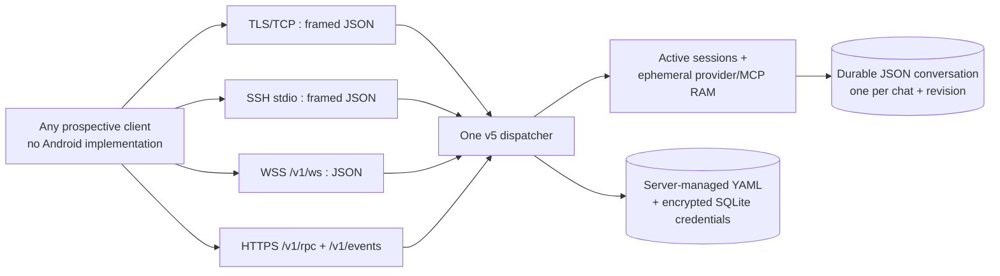
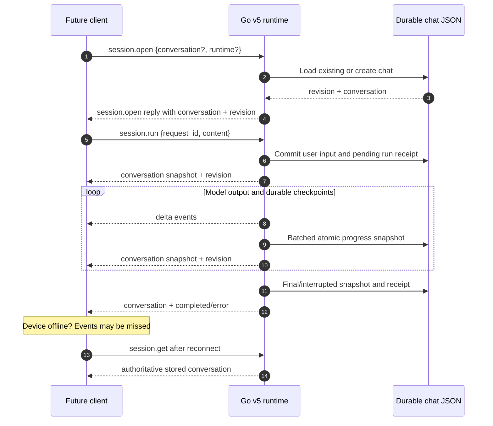

# ServerSide v5 — API offered to future clients

**Current server contract (2026-11-15): every conversation is stored durably on the Go server, independent of any mobile sync preference.** The Android app is **not** implemented or modified by this work. See [persistence plan](../plans/05-chat-sync.md), [transport plan](../plans/07-transport.md) and [future interface concepts](future-generative-interface.md).

## 1. Protocol architecture



Every ServerSide session uses durable chat storage. Provider/MCP credentials **supplied by a mobile client** exist only in the runtime RAM; the server's *locally managed* provider credentials use encrypted SQLite and are not confused with the mobile handoff.

## 2. Public API endpoints

| Endpoint / channel | Purpose | Authentication |
| --- | --- | --- |
| `GET /v1/capabilities` | Protocol version, transports, supported operations | TLS or local loopback policy |
| `POST /v1/pair` | Redeem a one-time HTTP/WS pairing URL code | HTTPS + trusted certificate/SPKI pin, code in JSON body |
| `POST /v1/auth` | Exchange paired HTTP/WS `client_id` and `secret` for a short-lived bearer token (currently 900 seconds) | Paired HTTP/WS credentials |
| `POST /v1/rpc` | Common v5 JSON request/reply | `Authorization: Bearer <token>` |
| `GET /v1/events?session_id=...&after=...` | Server events by SSE (default) or JSON long poll (`Accept: application/json`) | Same bearer |
| `GET /v1/ws` | Full-duplex JSON RPC and events | WS `auth` text frame first |
| TLS/TCP | Length-prefixed JSON frames (4-byte big-endian size) | SSH-enrolled TCP identity |
| `serverside stream --stdio` | Same framed RPC via SSH + private daemon socket | SSH-enrolled TCP identity |

Public HTTP requires correctly configured TLS/reverse proxy. Plaintext HTTP data API is allowed only on loopback, under the server's security policy. `/connect` serves the embedded developer console. Browsers cannot verify the invitation SPKI pin; verify the HTTPS certificate independently before redeeming the code.

## 3. Pairing and authentication

```mermaid
sequenceDiagram
    autonumber
    actor Operator
    participant CLI as ServerSide CLI
    participant Client as Future HTTP/WS client
    participant API as Go server
    Operator->>CLI: pair --transport http --endpoint HTTPS --pin SPKI
    CLI-->>Operator: Complete HTTPS URL + identical QR
    Operator-->>Client: Copy URL or scan QR
    Note over Client: Verify HTTPS/SPKI before sending one-time code
    Client->>API: POST /v1/pair {"code":"..."}
    API-->>Client: client_id + long-lived secret + endpoint + TLS pin
    Note over Client: Securely store paired identity; discard code
    Client->>API: POST /v1/auth {"client_id":"...","secret":"..."}
    API-->>Client: Bearer token + expiry
    Client->>API: POST /v1/rpc (Bearer token)
    API-->>Client: RPC reply
```

The server displays `https://host/connect#code=...&pin=sha256%2F...&v=1` as full copyable text and a QR with exactly the same URL. Never put the one-time fragment code into HTTP paths, logs or durable files. WebSocket first sends `{"type":"auth","protocol":5,"client_id":"...","secret":"..."}` and receives `{"type":"paired","protocol":5,"client_id":"..."}`.

**TCP is enrolled only via authenticated SSH**, e.g. `ssh -T USER@HOST serverside pair --stdio --transport tcp`. The resulting identity can use TCP or the SSH stdio fallback, but not HTTP/WS without explicit separate pairing. An HTTP/WS URL-paired identity cannot be used to enroll a TCP client.

## 4. Canonical RPC and automatic conversation delivery

A client does **not** send a sync or storage flag. The Go server always persists chat history; `runtime` carries transient provider/MCP settings only when needed.

Open/create a conversation:

```json
{"id":"open-1","op":"session.open","session_id":"chat-1","data":{"conversation":{"id":"chat-1","title":"Example","created_at":1,"updated_at":2,"messages":[]},"runtime":{"source":"mobile_ephemeral","provider":{"type":"openai","modelId":"example","auth":{"method":"bearer_token","value":"<RAM-only>"}}}}}
```

Successful response (actual field shape):

```json
{"id":"open-1","ok":true,"data":{"session_id":"chat-1","revision":1,"conversation":{"id":"chat-1","title":"Example","created_at":1,"updated_at":2,"messages":[]}}}
```

Start a job:

```json
{"id":"run-1","op":"session.run","session_id":"chat-1","data":{"request_id":"run-1","content":"Hello"}}
```

Successful acknowledgement:

```json
{"id":"run-1","ok":true,"data":{"request_id":"run-1"}}
```

The server emits `delta` events during text streaming and a `conversation` event containing the latest full stored chat and revision after the initial turn, at durable progress checkpoints and at completion. Example shape:

```json
{"session_id":"chat-1","seq":3,"request_id":"run-1","kind":"conversation","data":{"revision":2,"conversation":{"id":"chat-1","title":"Example","created_at":1,"updated_at":3,"messages":[]}}}
```

The event's `conversation.messages` is illustrative here. In reality it contains the newly stored user input and assistant/tool state; a client must not substitute the empty example for an actual response. A later `completed` event signals completion, while `error` reports a failed/interrupted operation. Event sequences are per active session, not persisted across daemon restarts.

| Operation | What it offers |
| --- | --- |
| `capabilities.get` | Discover version, operations and transports |
| `session.open` | Create/resume **durable** chat; no `storage`; optional initial `conversation` and transient `runtime` |
| `session.configure` | Replace transient provider/MCP/runtime settings in RAM |
| `session.run` / `session.cancel` | Start one request and optionally cancel by `request_id` |
| `session.get` | Full server conversation + `revision`; accepts `if_revision` and may return `unchanged` |
| `session.events` | Events after the requested `after` sequence |
| `session.save` | Explicit full chat edit; `expected_revision` and `idempotency_key` for atomic CAS |
| `session.list` | Stored owner-scoped chats and tombstones (persistent across restart) |
| `session.close` | Release RAM runtime only, **not** history |
| `session.delete` | Explicit durable chat deletion with tombstone and revision check |
| `tool.list` / `tool.call` | Discover/execute authorized tools |
| `config.get` / `config.save` | Server-managed nonsecret YAML configuration |
| `terminal.*` / `agent.*` | Optional native tools when enabled by server administrator |

`data.storage` from older v5 prototypes is ignored for interoperability, not used to choose server persistence. Clients should omit it in all new requests.

## 5. Streaming, reconnect and permanent recovery



- Event delivery is live/bounded, not a durable per-device queue. Clients use `session.get` after `event_gap` or restart; history is still on server storage.
- A cursor belongs to one active in-memory session. Discard it after session close, expiry or daemon restart, reopen the session and recover its snapshot. Sequence numbers can be reused in a new session, so an old cursor is not guaranteed to produce `event_gap`.
- Mobile-supplied provider/MCP credentials disappear after close, TTL expiry or server restart. Recovery can read the chat, but **new generation requires a new runtime handoff**.
- Never blindly replay an uncertain model/tool call; the server stores request receipts and may return `request_already_recorded`. Exactly-once effects outside the server cannot be guaranteed across all failures.
- Within the same active session, repeating a run with the same request ID and content returns the acknowledgement without starting another call; changing the content returns `request_already_recorded`. After reopening, a recorded request is rejected rather than executed again.
- Current logical conversation size is limited by a 4 MiB protocol frame and about 3 MiB stored snapshot handoff; larger chunked uploads/downloads are **future work**.
- Transport fallback stays within paired authorization groups: TCP ↔ SSH, WSS ↔ HTTPS.

## 6. Integration restrictions

This file documents the Go server API and prospective protocol consumers only. It does not authorize modifying, building or testing `~/generative`. Future UI/Room integration requires a separate decision. The server-side tests cover the core durable conversations, provider/MCP credential isolation and transport semantics; additional corrupted-data, large-snapshot and adversarial failover tests remain open.
