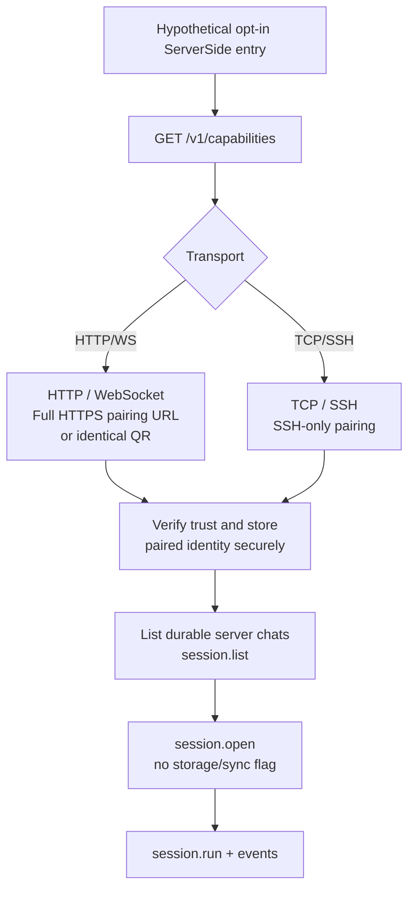
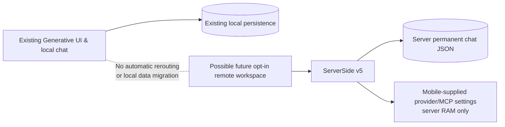
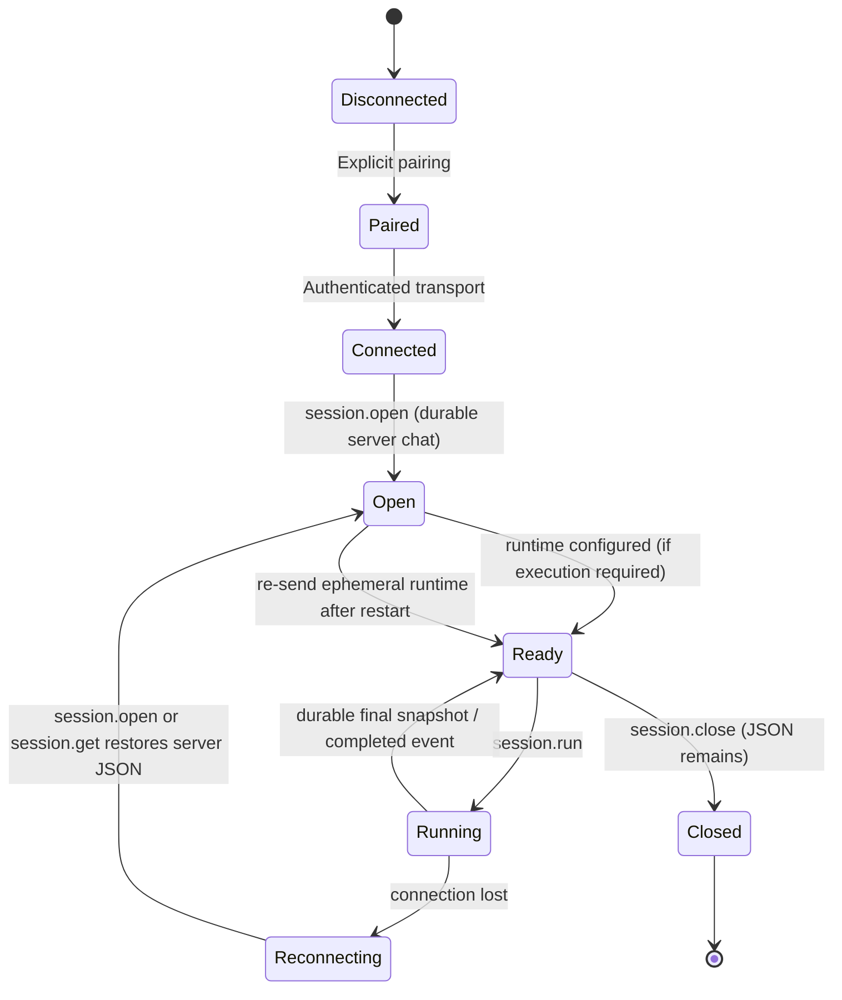
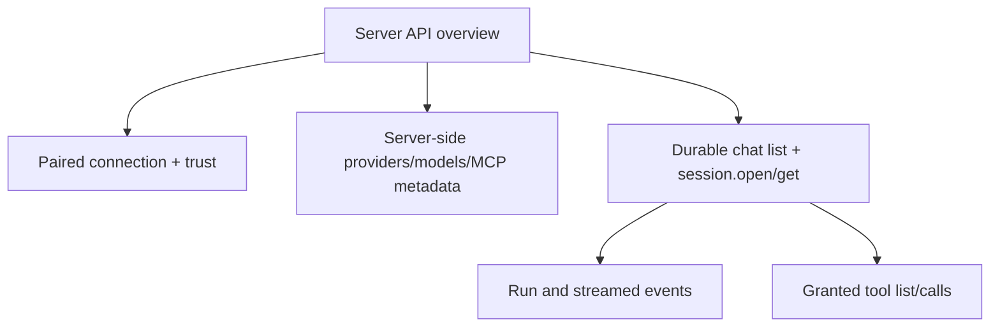

# Future Generative ↔ ServerSide interface concepts

**Design-only; no modifications to `~/generative`.** These diagrams describe a possible future opt-in client interface to the [ServerSide v5 API](client-api-surface.md), not Android UI, Kotlin, Room or Gradle implementation tasks.

## Conceptual onboarding and session selection

QR represents the same complete HTTPS URL as copyable text. Whether the **app** itself syncs or stores a chat locally has no effect on how the ServerSide daemon stores conversations: **every server chat is a durable JSON file**.

## Boundary between app policy and server data

| Topic | Server behavior | Future app decision |
| --- | --- | --- |
| Conversation storage | **Always persisted** in private JSON with revision | Whether/how the app separately stores or syncs its own copy |
| Server-delivered updates | `conversation` snapshot events, deltas and `session.get` | How a future client presents or acknowledges them |
| Provider/MCP from mobile | Session-scoped RAM; lost after server restart | Which config or credentials to explicitly supply |
| Local server provider config | YAML catalog + encrypted SQLite credentials | Whether to select an existing server provider |
| Pairing | SSH-only TCP or URL/QR HTTP/WS | User interface and secure identity storage (not implemented here) |

**No automatic local chat upload, Room rewrite or switch of existing app model requests** is specified. The Go daemon never reads a mobile app's local sync setting.

## Session lifecycle concept

The chat survives a process restart and a lost network connection. Transient credentials do **not** survive; execution requires fresh runtime settings. On uncertain external model/tool calls, inspect recorded status instead of replaying the request.

## Proposed information groups, not actual screens

This conceptual hierarchy intentionally avoids prescribing Compose widgets, Android navigation, a local Room schema, developer-feature hooks or a production release. Those decisions require a separate, explicit request.

**Current scope exclusion:** do not modify `~/generative` anywhere, including `extensions/` or Developer features, and do not build/test Android. All current executable work belongs only to `~/serverside-generative`.
